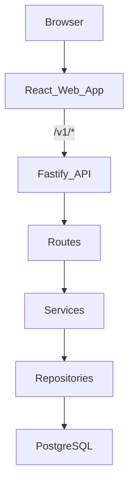

# IIT BHU Alumni Platform

Alumni directory and networking platform for IIT BHU (Varanasi). The system verifies institutional identity, lets alumni complete profiles, search the directory, post intentcasts, send contact requests, and manage connection threads.

## Core Concepts

- **Verified session**: users authenticate through OTP, magic link, Google OAuth, or supported password/admin flows; the API stores an HTTP-only session cookie.
- **Directory profile**: alumni profiles power search, onboarding gates, batch snapshots, and public profile pages.
- **Intentcasts**: time-boxed bulletin posts for hiring, mentorship, collaboration, and guidance.
- **Contact and messaging**: contact requests create connection threads where alumni can exchange messages and disclose contact details.
- **Admin workflows**: admins manage people, organization suggestions, duplicates, and platform metrics.

## System Flow



The browser calls relative `/v1/*` paths. In development, Vite proxies those calls to the API on port `4000`. In production, `apps/web/vercel.json` rewrites `/v1/*` to the hosted API so auth cookies remain first-party from the browser's perspective.

## Folder Structure

```text
Repo 2/
├── apps/
│   ├── api/          # Fastify REST API, PostgreSQL, migrations, jobs
│   └── web/          # Vite React app, route pages, UI components
├── docs/             # Architecture, data flow, contracts, decisions, product notes
└── README.md
```

## Where To Start Reading

1. [`docs/architecture.md`](docs/architecture.md) for the app layout and ownership boundaries.
2. [`docs/data-flow.md`](docs/data-flow.md) for auth, request, and backend flow.
3. [`docs/api-contracts.md`](docs/api-contracts.md) for the `/v1` surface consumed by the web app.
4. [`apps/api/src/app.ts`](apps/api/src/app.ts) for API wiring, services, auth prehandlers, routes, and error handling.
5. [`apps/web/src/App.tsx`](apps/web/src/App.tsx) for route registration and auth/profile gates.

## Quick Start

Start the API:

```bash
cd apps/api
cp .env.example .env
npm install
npm run migrate
npm run dev
```

To use the **same database as production** when running the API locally, set `DATABASE_URL` (and matching `AUTH_SECRET_PEPPER`) per `apps/api/.env.example` and [docs/deployment.md](docs/deployment.md) (“Local API using the production database”). Use a modest `DATABASE_POOL_MAX` against hosted Postgres.

Start the web app:

```bash
cd apps/web
npm install
npm run dev
```

The API runs at `http://localhost:4000`. The web app runs at `http://localhost:5173` and proxies `/v1/*` to the API in development.

## Testing And Verification

API:

```bash
cd apps/api
npm test
npm run build
```

Web:

```bash
cd apps/web
npm run lint
npm run build
```

Auth integration tests require a PostgreSQL database. Set `DATABASE_URL` or use the default test URL documented in `apps/api`.

## Production Checklist

Before deploying:

1. Set `CORS_ORIGIN` to the frontend origin or origins. The development fallback is not a production policy.
2. Set `EMAIL_PROVIDER=resend`, `RESEND_API_KEY`, and `EMAIL_FROM` for real email delivery.
3. Schedule `npm run job:intentcasts:expire` to auto-close intentcasts after the configured window.
4. Verify `/v1/*` routing, cookies, CORS, login, logout, and `/healthz` in the deployed environment.

## Documentation

- [Architecture](docs/architecture.md)
- [Data flow](docs/data-flow.md)
- [API contracts](docs/api-contracts.md)
- [Decisions](docs/decisions.md)
- [MVP Roadmap](docs/mvp-roadmap.md)
- [Phase 1 Verification](docs/phase1-verification.md)
- [Bulletin feed ranking](docs/bulletin-feed-ranking.md)