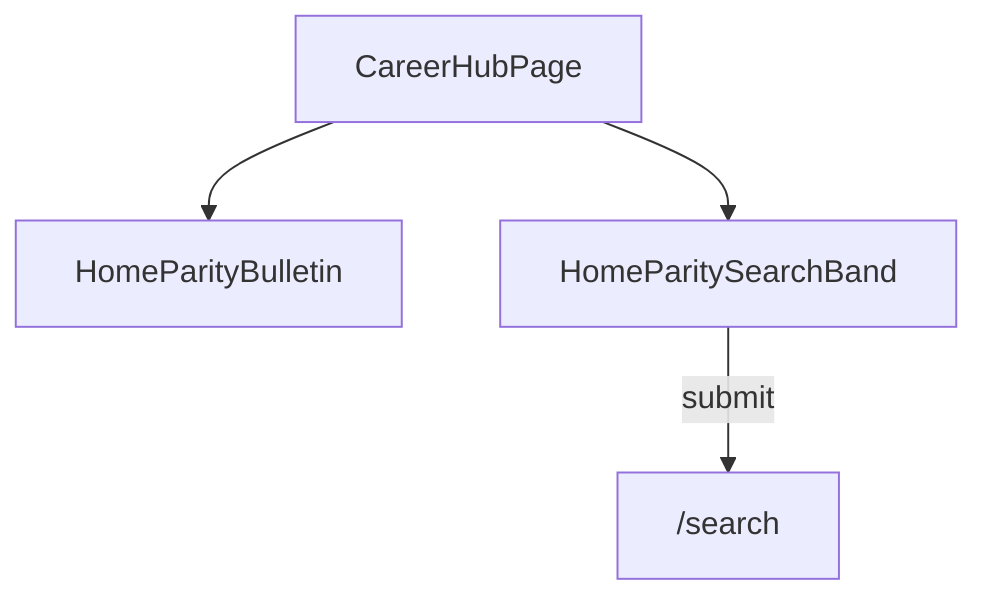

# Career page: jobs, referrals, and post a role

## Current state

- [`apps/web/src/pages/IntentPage.tsx`](apps/web/src/pages/IntentPage.tsx) renders the same “coming soon” copy for every `/intent/:intentSlug` route, including **`/intent/career`**.
- **Home** ([`apps/web/src/pages/Home.tsx`](apps/web/src/pages/Home.tsx)) implements:
  - **Directory search band**: [`DirectorySearchBar`](apps/web/src/components/DirectorySearchBar.tsx), filters, `navigateToDirectorySearch()` → **`/search`**.
  - **Bulletin**: intentcasts feed (`GET /v1/intentcasts`), category chips (hiring / mentorship / collaboration / guidance), compose, reply, edit/delete, infinite scroll, etc. — large inline implementation in `Home.tsx`.
- **Search results** ([`apps/web/src/pages/Search.tsx`](apps/web/src/pages/Search.tsx)) — referral flow ends there after submit, same as from Home.
- Bulletin category filter and compose are **client state only** on Home today (no URL sync), unless you add the optional deep-link params below.

## Recommended UX (three paths)

Hiring managers are covered **only** by **posting a role** (bulletin composer). There is **no** “find candidates” directory path.

| User goal | What we offer (product copy + action) | Implementation note |
|-----------|--------------------------------------|---------------------|
| **Find jobs** | **Same bulletin as Home**: feed, category filters, compose, replies — not a separate “jobs product.” Default UX should emphasize **job-related posts** (e.g. initial category filter **`hiring`**, still user-overridable like Home). | Embed or extract Home’s bulletin block so behavior and API match Home. |
| **Find people for a referral** | **Same directory search as Home**: keyword + Refine → submit → **`/search`**. | Mirror Home’s search band (see below). |
| **Hiring: post a role** | Post a **Hiring** bulletin. | Same composer as bulletin; this section can be **short copy + focus** (e.g. pre-select Hiring, scroll to compose) or a duplicate compose entry point wired to the same state as the bulletin above. |

## Implementation plan

### 1. Add a dedicated `CareerPage`

- New file e.g. [`apps/web/src/pages/CareerPage.tsx`](apps/web/src/pages/CareerPage.tsx).
- Structure:
  - Page title **Career** and short intro.
  - **Find jobs**: **Home-parity bulletin** — same capabilities as the bulletin region in [`Home.tsx`](apps/web/src/pages/Home.tsx) (load feed, category chips, compose with categories, reply/edit flows as on Home). For “find jobs,” **default `bulletinCategoryFilter` to `hiring`** when the Career page mounts (users can switch to All / other tags like on Home).
  - **Referrals**: **Home-parity search band** — mirror state/handlers for `searchQuery`, filters, `navigateToDirectorySearch`, counts, clear; reuse **`DirectorySearchBar`**, **`DirectoryFilterDrawer`**, **`DirectoryFiltersForm`** as on Home; initialize batch/dept from profile like Home where applicable.
  - **Post a role**: Copy aimed at hiring managers; wire to **the same bulletin composer** (category `hiring`) — e.g. button that sets `postOpen`, `postCategory: hiring`, and scrolls to the bulletin panel, **or** rely on the bulletin **Compose** button in the jobs section with no third duplicate UI (pick one; prefer minimal duplication).

### 2. DRY vs duplicate

- **Bulletin** on Home is large. Prefer **extracting** a **`BulletinPanel`** (or `HomeBulletinSection`) used by both `Home` and `CareerPage` *if* you can do so without risky behavior drift; otherwise **duplicate** the bulletin block into `CareerPage` for a smaller first PR, then refactor.
- **Search band**: same tradeoff — optional **`DirectorySearchBand`** / `useHomeDirectorySearchState` shared with Home.

### 3. Wire routing from `IntentPage`

- In [`IntentPage.tsx`](apps/web/src/pages/IntentPage.tsx), **`if (intentSlug === "career") return <CareerPage ... />`**.

### 4. Deep links (optional)

- **Career** may live entirely on `/intent/career` with embedded bulletin; deep links to **`/home`** become less important for “find jobs.”
- Still useful for **Post a role** bookmarks or email links: optional [`Home.tsx`](apps/web/src/pages/Home.tsx) query params (`?bulletinCategory=hiring`, `?compose=1&postCategory=hiring`) as in the earlier plan — **Career page can use the same params** if you add a shared hook to initialize bulletin state from `useSearchParams` on both routes.

### 5. Out of scope

- Hiring managers **searching the directory for candidates**.
- New job-board backend; ATS integrations.
- Changing bulletin category enum.

## Files to touch

| File | Role |
|------|------|
| New [`apps/web/src/pages/CareerPage.tsx`](apps/web/src/pages/CareerPage.tsx) | Hub: **bulletin (jobs)** + **search (referrals)** + post-role copy/actions |
| [`apps/web/src/pages/IntentPage.tsx`](apps/web/src/pages/IntentPage.tsx) | Branch to `CareerPage` for `career` |
| Optional refactor of [`apps/web/src/pages/Home.tsx`](apps/web/src/pages/Home.tsx) | Extract shared bulletin and/or search band |
| [`apps/web/src/styles/components.css`](apps/web/src/styles/components.css) | Career layout; bulletin/search sections should **match Home** visually |

## Verification

- **`/intent/career`**: Jobs area behaves like Home’s bulletin (including default **Hiring** filter); referrals match Home search submit → **`/search`**; post-a-role path opens **Hiring** compose or matches chosen minimal pattern.
- No regression on **`/home`** bulletin/search if extracted.
