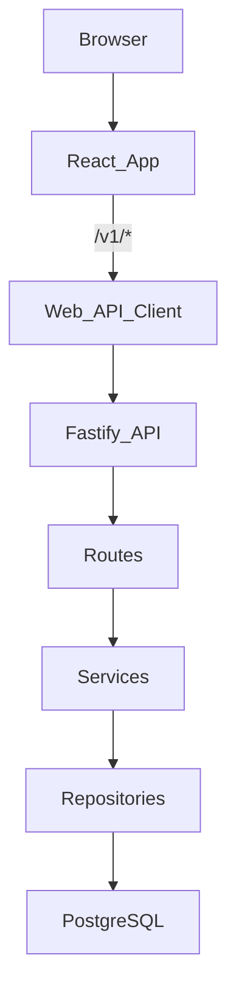

# Architecture

The IIT BHU Alumni Platform is a two-app TypeScript repo:

- `apps/web`: Vite + React single-page app.
- `apps/api`: Fastify REST API backed by PostgreSQL.

There is no root package workspace. Each app owns its own `package.json`, lockfile, scripts, and dependencies.

## Runtime Shape

## Web App

The web app starts at `apps/web/src/main.tsx` and renders `apps/web/src/App.tsx`.

Important folders:

- `src/pages`: route-level screens.
- `src/components`: shared UI and larger page sections.
- `src/contexts`: app-wide React context, currently auth.
- `src/api`: browser API transport and response DTO types.
- `src/lib`: shared web helpers, query keys, and flow logic.
- `src/constants`: client constants and shared catalog re-exports.

`App.tsx` owns route registration and route guards. Authenticated pages use `RequireAuth`; profile-gated pages use `ProfileGate`.

## API App

The API starts at `apps/api/src/index.ts`, which creates the Fastify app from `apps/api/src/app.ts`.

Important folders:

- `src/routes`: HTTP request parsing, auth prehandlers, response codes.
- `src/services`: business rules and orchestration.
- `src/repos`: PostgreSQL queries and row-to-view mapping.
- `src/db`: pool, migrations, and migration runner.
- `src/constants`: domain constants used by API behavior.
- `src/jobs`: CLI/cron-style background jobs.

The API should continue to follow route -> service -> repository. Do not move database queries into routes or browser-facing DTO decisions into repositories.

## Shared Concepts

The web app imports the API department catalog through the Vite alias `@department-catalog`. This is the approved pattern for small static catalogs that both apps need.

Do not casually refactor:

- SQL migration history.
- `dist` build output.
- `node_modules`.
- lockfiles unless dependencies changed through npm.
- static media in `apps/web/public`.
