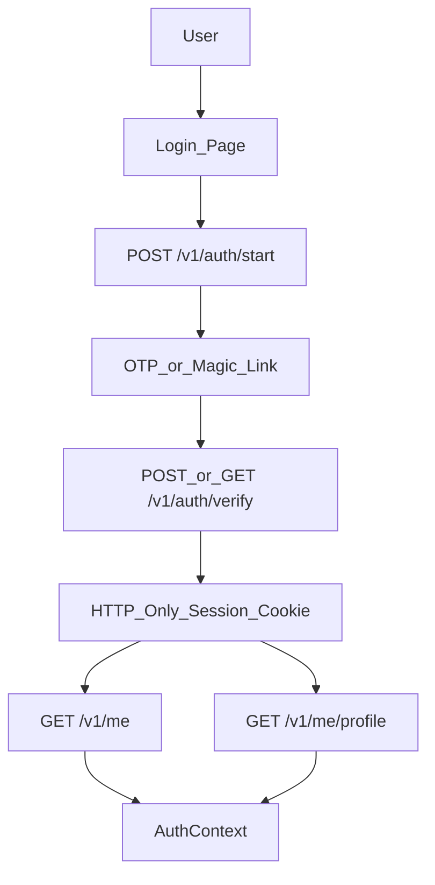
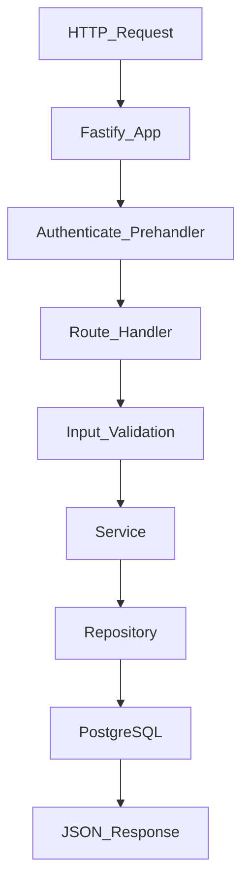

# Data Flow

This document describes the shipped data flow. Demo/mock auth is not part of the runtime.

## Browser To API

The web app calls API routes through `apps/web/src/api/client.ts`.

- Local development: Vite proxies `/v1/*` to `http://localhost:4000`.
- Production: `apps/web/vercel.json` rewrites `/v1/*` to the hosted API.
- Requests use `credentials: "include"` so the session cookie is sent with API calls.

`VITE_API_URL` can override the API origin in local development. Production defaults to same-origin `/v1/*` so browser cookie behavior stays predictable.

## Authentication Flow

`AuthProvider` loads the current session through `fetchAuthSession`, which requests `/v1/me` and `/v1/me/profile`. If the user is not authenticated, route guards redirect to `/login`.

Logout calls `POST /v1/auth/logout` and clears the TanStack Query cache.

## Page Data Flow

Most route pages use TanStack Query with helpers from `src/lib/queryKeys.ts` and `src/lib/assertApiGet.ts`.

- `assertApiGet` converts structured API errors into thrown errors for query state.
- `api.get`, `api.post`, `api.patch`, and `api.delete` share JSON request handling.
- `apiPostForm` is reserved for multipart uploads and mirrors the same network-error behavior.

## Backend Request Flow

Routes validate request payloads and query strings with Zod. Services enforce business rules. Repositories own SQL and map database rows into application views.

## External And Background Flows

- Email delivery is handled by the configured email sender service.
- Intentcast expiry runs through `npm run job:intentcasts:expire`.
- Health checks hit `GET /healthz`, which verifies database connectivity with `SELECT 1`.

## Important Invariants

- All authenticated business routes must use `app.authenticate`.
- Browser API calls should prefer relative `/v1/*` paths unless a local override is required.
- Route handlers should not contain SQL.
- Repositories should not make HTTP response decisions.
- Demo/mock API behavior must not be reintroduced into production code paths.
